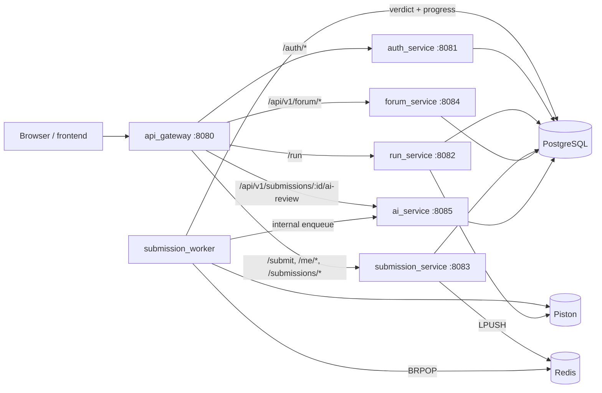
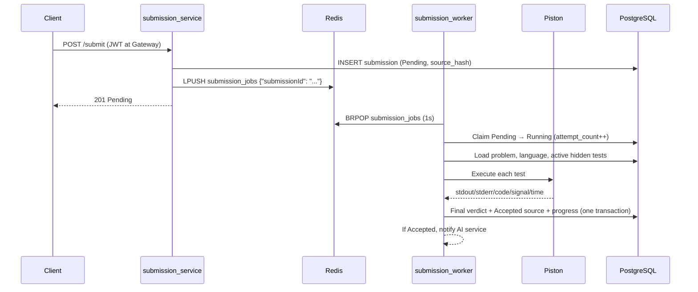

# Codjingrank Backend

Go monorepo for the standalone coding practice platform. Product baseline:
[decisions](docs/DECISIONS.md), [SRS](docs/srs/01_SRS_Coding_Judge_Platform.md)
and [frontend contract](docs/FRONTEND_API_CONTRACT.md).

## Structure and current status

- `api_gateway/`: public entrypoint (:8080). Owns JWT validation for proxied
  learner routes, the UUID catalog and admin handlers, the leaderboard, and
  reverse proxies for Auth, Run, Submission, Forum and AI.
- `auth_service/`: password authentication, JWT and refresh-cookie sessions
  (:8081).
- `run_service/`: synchronous sample execution using Piston (:8082).
- `submission_service/`: Pending submission API (:8083), Redis list queue and
  asynchronous worker (no HTTP port).
- `forum_service/`: posts, comments, likes and moderation (:8084).
- `ai_service/`: Accepted-only AI review API and background review worker
  (:8085).
- `shared/`: configuration, models, response envelope, middleware, catalog,
  judge, Piston client and language helpers.
- `schema.sql`: clean shared PostgreSQL 16 bootstrap for Package → Level →
  Problem, submissions, progress, Forum and AI review.
- `tests/schema/`: bootstrap and constraint checks.

**Backend through Sprint 4 implemented:** UUID Auth/refresh, v1 learner/admin
catalog, Run/Submit access checks, owner/active-admin submission detail,
filtered history/latest/UTC stats, worker recovery, transactional Accepted
progress/unlock, the leaderboard, Forum and Accepted-only AI review. See
[Sprint 2](docs/SPRINT2_ACCEPTANCE.md),
[Sprint 3 acceptance](docs/SPRINT3_ACCEPTANCE.md) and
[Sprint 4 acceptance](docs/SPRINT4_ACCEPTANCE.md) for evidence and
compatibility.

Remaining gaps include full profile update, password recovery, live-provider
acceptance/spend controls, exact per-problem CPU/output enforcement, and
adversarial/load sandbox certification. This is not a production release.

Repository/GitHub integration and the legacy Subject/Session/Lesson curriculum
were removed. `schema.sql` is the current schema truth and is not a migration
for an existing database.

## Operating Flows

### 1. Architecture and services

In the Compose topology the Gateway is the only browser-facing service. Every
base port is bound to `127.0.0.1`, and the production override removes all
ports except the Gateway.

| Component | Port | Role |
|---|---|---|
| `api_gateway` | 8080 | Public edge: JWT validation, catalog/admin/leaderboard handlers, reverse proxies, CORS, rate limit, body limit, request ID |
| `auth_service` | 8081 | bcrypt login/register, HS256 access tokens, refresh-token rotation and revocation |
| `run_service` | 8082 | Synchronous execution of sample cases only |
| `submission_service` | 8083 | Submission API: creates `Pending` rows and enqueues jobs |
| `submission_worker` | — | Redis consumer: executes hidden tests, persists verdict/progress, notifies AI after Accepted |
| `forum_service` | 8084 | Posts, one-level comments, idempotent likes, moderation, Markdown sanitization |
| `ai_service` | 8085 | Public review read API plus internal enqueue and review worker |
| PostgreSQL | 5432 | Single shared database; `schema.sql` is the fresh bootstrap |
| Redis | 6379 | List queue `submission_jobs` |
| Piston | 2000 | Sandboxed code execution; digest-pinned image, privileged, networking disabled |



### 2. Data model

- `packages` contain exactly three `levels`: `level_no` 1/2/3 with difficulty
  `easy`/`medium`/`hard`. The database enforces this with a unique constraint,
  a check constraint, and a publish guard.
- `problems` belong to one level. UUIDs are used throughout the public API.
- A package can be published only when it has exactly three levels. A problem
  can be published only when it has an assigned language, at least one sample
  and at least one active hidden test.
- Samples and hidden tests become immutable after problem publication; clone
  the problem to change judge data.
- Execution detail includes `execution_mode` (`stdin_stdout` or `function`),
  `time_limit_ms`, `memory_limit_mb` and `output_limit_bytes`.
- `submissions` keeps `source_code`, `source_hash`, status, attempt count,
  claim/heartbeat timestamps and verdict counters. `accepted_solutions` is
  unique per `(user, problem, language, source_hash)`.
- `user_problem_progress` is the progression and ranking source. Forum tables
  and `ai_reviews`/`ai_review_findings` are separate from verdicts.
- `schema.sql` is a **destructive clean bootstrap**, never a migration. Compose
  applies it only to a fresh PostgreSQL volume; existing volumes are never
  reset automatically. It seeds the three languages only; no demo packages,
  problems or users are committed in this repository.

### 3. Auth flow

1. `POST /auth/register` validates email/password/username, hashes the password
   with bcrypt, creates the user, and returns `201` with an access token. It does
   not set a refresh cookie.
2. `POST /auth/login` compares the bcrypt hash, returns an HS256 access token
   (default 15 minutes) and a random refresh token in an `HttpOnly` cookie
   (default 7 days, `SameSite=Lax`, path `/`). Only a SHA-256 hash of the refresh
   token is stored.
3. The Gateway validates the Bearer JWT on protected proxied routes, strips
   client `Authorization` and `X-User-*`, then injects trusted `X-User-ID`,
   `X-User-Email` and `X-User-Role` headers for internal services. Downstream
   services do not parse Browser JWTs on those routes.
4. `POST /auth/refresh` reads the cookie, checks revocation and expiry, rotates
   the token (old token revoked, new cookie set), and returns a new access
   token. `POST /auth/logout` revokes the current cookie token and clears the
   cookie; it returns `200` even when revocation is best effort.
5. Refresh and logout enforce an Origin/Referer allowlist derived from
   `CORS_ALLOWED_ORIGINS`; a disallowed browser origin gets `403`. Requests with
   neither header (CLI/server-to-server) are allowed.
6. `GET /auth/me` requires a valid session and returns the current user.
7. The v1 facade maps `POST /api/v1/auth/{login,register,refresh,logout}` to the
   root Auth routes. `GET /api/v1/users/me` is rewritten to Auth
   `GET /auth/me`. There is no `/api/v1/auth/me` route.

Forum and AI review keep a different boundary: their Gateway proxies strip only
`X-User-*` and forward `Authorization`; each service validates the JWT itself and
checks the user's active flag and role in PostgreSQL. Catalog, admin and
leaderboard handlers run inside the Gateway with the same JWT middleware.

### 4. Catalog and level unlock

- Public learner catalog:
  `GET /api/v1/languages`, `/tags` (optional Bearer is validated but does not
  personalize the response) and authenticated `/packages`, `/packages/{slug}`,
  `/packages/{slug}/levels`,
  `/problems`, `/problems/{slug}`, `/problems/{slug}/languages`,
  `/problems/{slug}/samples`, `/problems/{slug}/template?languageId=...`.
- Only published packages and problems are visible.
- A level is unlocked when every published problem in **all lower-numbered
  levels of the same package** has a `user_problem_progress` row, which only
  exists after an Accepted submission. Correctness does not depend on the
  immediately previous level alone.
- Empty levels never block progression. In the level-list read model a level
  with zero published problems is complete, so the next level stays unlocked.
- Run and Submit share the same execution policy: active user, published
  package/problem, unlocked level, and an active language assigned to the
  problem. Failures map to `404`, `403 LEVEL_LOCKED`,
  `403 ACCOUNT_INACTIVE`, or `422 LANGUAGE_NOT_SUPPORTED`.

### 5. Run (synchronous)

`POST /run` (and `/api/v1/run`) executes the submitted code against the
problem's **sample** cases only. It never creates a submission, verdict or
progress row.

- The problem/language are loaded, then every sample is executed through Piston.
- In `function` mode, the executed source is
  `user_code + "\n\n" + wrapper_code`, where `wrapper_code` comes from the
  problem/language `code_templates` row. A missing function wrapper is a
  configuration error.
- Per-test results include expected/actual output, runtime, error type and
  stderr. After the first compilation error, remaining samples are reported as
  Compilation Error.
- The Piston HTTP client has a 30-second timeout and rejects responses larger
  than 4 MiB. Provider timeout/unavailability maps to `504`/`502`.
- Overall status follows the shared precedence used by judging:
  Compilation > Internal > TLE > RTE > Wrong Answer > Accepted. Run itself
  never emits Internal; Piston transport failures map to HTTP `502`/`504`.

### 6. Submit → Judge (asynchronous)



- `POST /submit` (and `/api/v1/submit`) validates the same execution policy as
  Run, inserts a `Pending` submission, and enqueues it. Enqueue is best effort:
  if Redis is unavailable the row stays `Pending` and recovery can re-enqueue it.
- The database trigger rejects a second submission for the same user/problem
  within 10 seconds (`429`).
- The worker consumes `submission_jobs` with `BRPOP` (1-second block). The JSON
  payload is `{"submissionId":"<uuid>"}`.
- Only one worker can claim a `Pending` row: the claim increments
  `attempt_count` and sets `Running` + `claimed_at`. Duplicate delivery is a
  no-op because the claim no longer matches `Pending`.
- All active hidden test cases are executed. Compilation stops further
  execution. Piston errors become Internal Error.
- Verdict precedence is **Compilation > Internal > TLE > RTE > Wrong Answer >
  Accepted**. `Accepted` requires every hidden test to pass.
- A final write is fenced by the current `Running` status and `attempt_count`, so
  a stale worker cannot overwrite a recovered result.
- Delivery is **at-least-once**, not exactly-once: a lost or stale job may be
  executed again, while database effects remain fenced/idempotent.

### 7. Worker recovery

- Recovery runs at worker startup and every 30 seconds.
- Stale `Pending` rows older than 30 seconds and `Running` rows whose heartbeat
  is older than 2 minutes are selected in batches of up to 100.
- `attempt_count >= 3` exhausts the row to `Internal Error` with
  `Judging retries exhausted`. Otherwise it returns to `Pending`, clears claim
  fields, and is re-enqueued.
- A running worker refreshes `claimed_at` every 15 seconds; the heartbeat only
  updates the current attempt.
- Because recovery re-enqueues rather than replaying a remote execution,
  exactly-once Piston execution is not guaranteed; final database writes are
  fenced.

### 8. Progress and unlock on Accepted

When the worker finalizes `Accepted`, one transaction:

1. Updates the submission only if it is still `Running` with the expected
   attempt.
2. Inserts into `accepted_solutions` with
   `ON CONFLICT (user, problem, language, source_hash) DO NOTHING`.
3. Upserts `user_problem_progress`, incrementing `accepted_count` only when the
   accepted-source insert actually inserted a new row.
4. Updates first/last solved timestamps and best runtime/memory.

Consequences:

- Re-submitting the exact same source does not increase `accepted_count`.
- A different accepted source for the same problem/language does increase it.
- Unlock is computed dynamically from progress on every read; no separate unlock
  table or background recomputation is used.

### 9. History and statistics

- `GET /me/submissions` (and `/api/v1/me/submissions`) is paginated
  `{items, page, size, total}` with default `page=1`, `size=20`, maximum
  `size=100`. Filters: `problemId`, `languageId`, `status`. The source code is
  never included in list items.
- `GET /me/submissions/{problemId}/latest` accepts an optional `languageId`.
  A missing submission returns `200` with `{"submission": null}` when the
  problem is visible; an invisible problem returns `404`.
- `GET /me/submissions/{id}` returns source code and verdict detail only to the
  owner or an active database admin. Outsiders receive `404`; inactive accounts
  receive `403`.
- `GET /me/stats` reads one repeatable-read snapshot:
  - `solvedCount` is distinct solved problems by difficulty.
  - `activity` groups Accepted submissions by UTC date.
  - `streak` uses UTC dates (`currentStreak`, `maxStreak`,
    `lastActiveDate`).
  - `rank` comes from the progress-backed leaderboard view; it is `null` when
    the user has no progress, and `totalUsers` counts active users.
  - AI score and rating are never read.

### 10. Leaderboard

`GET /api/v1/leaderboard` ranks users with progress:

- Primary sort: distinct solved problems descending.
- Tie-break: total accepted solutions descending.
- `RANK()` is used, so ties share a position and the next position has a gap.
- `scope=all|week|month`; week starts Monday 00:00 UTC, month starts on the 1st
  at 00:00 UTC, and both use `first_solved_at`.
- `package=<slug>` restricts to a published package.
- Pagination defaults to `page=1`, `size=50`, maximum `size=100`.
- Guests (no `Authorization`) may read only `scope=all`, `page=1`, `size<=50`;
  other guest requests return `401`. An invalid supplied token returns `401`,
  and an inactive account returns `403 ACCOUNT_INACTIVE`.
- `GET /api/v1/leaderboard/me` requires authentication and returns the caller's
  single entry (or `null` when unranked). It does not paginate.
- AI score never contributes to ranking.

### 11. Forum

- Routes: `/api/v1/forum/posts` (list/create), `/posts/{id}` (get/update/delete),
  `/posts/{id}/comments` (list/create), `/comments/{id}` (update/delete), and
  `/posts/{id}/like` (`PUT`/`DELETE`).
- Reads are public and may include a Bearer token to personalize `likedByMe`.
  Writes require a valid session. Admin moderation routes under
  `/api/v1/admin/forum/**` require the database `admin` role.
- Post types are `discussion`, `question` and `solution`. Public post-list
  responses omit `contentMd`/`codeSnippet`; detail responses include them.
- `solution` posts require an existing `user_problem_progress` row for the
  selected problem, i.e. a prior Accepted solution. A solution post without a
  selected problem, or without that progress, gets `403 SOLUTION_NOT_ALLOWED`.
- Comments support one level only: a parent must be a top-level, non-deleted
  comment on the same post. A bad parent gets `422 INVALID_COMMENT_PARENT`.
- Likes are idempotent: `PUT` uses `ON CONFLICT DO NOTHING`, `DELETE` removes an
  existing row, and counters change only when the row actually changes.
- View counts are deduplicated per signed-in user or per guest `forum_session`
  cookie, so a refresh does not inflate them.
- Deletes are soft (`status=deleted` / `is_deleted=true`). Deleted comments
  expose `content: null`; a deleted post cannot be restored by moderation.
- Markdown is parsed with Goldmark. Raw HTML is escaped and link/image
  destinations are restricted to `http`, `https` and `mailto`. The frontend
  must still render through its own sanitizer.

### 12. AI review

AI review is advisory and completely separate from the verdict, progress and
leaderboard.

- The worker calls the AI service only **after** an Accepted verdict has been
  committed. The `ai_reviews` database trigger and the internal enqueue route
  also reject non-Accepted submissions.
- `POST /internal/reviews/{id}` is internal-only, protected by
  `AI_INTERNAL_SECRET` (`Authorization: Bearer ...`). It is not exposed through
  the Gateway.
- AI is disabled unless `AI_PROVIDER_URL`, `AI_PROVIDER_MODEL` and
  `AI_ENABLED_SINCE` (RFC3339) are all set. The cutoff excludes older Accepted
  submissions. The worker also reconciles missing reviews every 15 seconds.
- The provider adapter speaks the **OpenAI chat completions** protocol. It sends:

  ```json
  {
    "model": "<AI_PROVIDER_MODEL>",
    "messages": [
      {"role": "system", "content": "<Vietnamese review instructions>"},
      {"role": "user", "content": "Language, problem statement and source"}
    ],
    "temperature": 0,
    "response_format": {"type": "json_object"}
  }
  ```

  The model's `choices[0].message.content` must contain the JSON object; a
  surrounding Markdown fence is stripped before validation.
- `AI_PROVIDER_URL` is the **full chat-completions endpoint**, not a base URL.
  In the production deployment it is
  `https://opencode.ai/inference/go/openai/v1/chat/completions`, and
  `AI_PROVIDER_MODEL` is `deepseek-v4.1-flash`.
- Every provider request carries the stable session header
  `x-opencode-session: codjingrank-ai-review`. When `AI_PROVIDER_TOKEN` is set,
  it also sends `Authorization: Bearer <token>`.
- The system prompt is Vietnamese. It requires exactly one JSON object with
  `score` (0–100), non-empty `summary`, numeric `dimensions`
  (`readability`, `maintainability`, `timeEfficiency`, `spaceEfficiency`) and
  optional `findings` (`severity` info/warning/error, line bounds, title,
  explanation, suggestion). It also tells the model that the server-side
  driver wrapper handles stdin/stdout, so solutions are not penalized for
  returning a function value instead of reading input.
- Timeout is 30 seconds and responses are limited to 1 MiB.
- Retry semantics: HTTP `429` and `5xx` are transient and may be retried up to
  three attempts; `400` and other non-retryable responses fail permanently.
- Review states are `queued`, `running`, `completed`, `failed`.
  - Claims are `FOR UPDATE SKIP LOCKED`; an active review is not claimed twice.
  - A stale `running` review older than 2 minutes is reclaimable.
  - Three failed attempts, or a permanent provider error, move the review to
    `failed` without changing the Accepted verdict.
- `GET /api/v1/submissions/{id}/ai-review` requires a session and allows only the
  owner or an active admin. It returns `404` for a missing/foreign submission,
  `409 AI_REVIEW_NOT_ELIGIBLE` when the submission is not Accepted, and `200`
  with `review: null` when no review exists yet. Failed reviews expose a generic
  message, never provider diagnostics.
- Provider failure never changes the Accepted verdict, progress or rank.

### 13. Response envelope

All JSON endpoints use the shared envelope:

```json
// success
{"status":"success","code":200,"message":"OK","data":{}}

// error
{"status":"error","code":404,"message":"Not found","error":"NOT_FOUND","details":null}
```

- `code` is numeric and equals the HTTP status.
- `error` is a stable string code (for example `VALIDATION_ERROR`,
  `LEVEL_LOCKED`, `ACCOUNT_INACTIVE`, `AI_REVIEW_NOT_ELIGIBLE`).
- `details` is always present and nullable; field validation uses
  `{"field":"email"}`.
- `204 No Content` responses have no body (for example Forum deletes). HEAD
  responses are bodyless. Mux-generated `404`/`405` responses also use the
  envelope.

### 14. Deployment and CI/CD

Production-style Compose uses the base file plus the override:

```bash
docker compose -p codjingrank -f docker-compose.yml -f docker-compose.prod.yml up -d --build
```

- Base Compose binds every published port to `127.0.0.1`.
- The production override publishes **only** `api_gateway` on
  `127.0.0.1:8080` and resets every other service's ports. TLS and external
  ingress are expected in front of the Gateway.
- Compose `!reset`/`!override` requires Compose >= 2.24.4.
- Piston is digest-pinned, privileged, has networking disabled, and needs a
  runtime installed (`make piston-install` installs Python 3.10.0).
- `schema.sql` is applied by the PostgreSQL image only on a fresh volume.
  Existing databases require an explicit additive upgrade.
- `.github/workflows/backend-ci.yml` runs on pull requests and pushes to `main`:
  gofmt, `go test`, `go vet`, `go build`, Redis recovery integration, contract
  validation against both OpenAPI files, schema bootstrap/constraints, OpenAPI
  lint, the production port-boundary check and Docker builds. The real-Piston
  smoke is manual (`workflow_dispatch`).
- `.github/workflows/api-docs.yml` lints both OpenAPI files and publishes the
  API reference to GitHub Pages on `main`.
- `.github/workflows/deploy.yml` **exists** and auto-deploys on every push to
  `main` (and on manual dispatch). It uses
  `appleboy/ssh-action@v1.2.0` with `DEPLOY_HOST`, `DEPLOY_PORT`,
  `DEPLOY_USER` and `DEPLOY_SSH_KEY`, then runs:

  ```bash
  cd /opt/codjingrank/backend
  git fetch origin --prune
  git checkout main
  git pull --ff-only origin main
  docker compose -p codjingrank -f docker-compose.yml -f docker-compose.prod.yml up -d --build
  ```

- The frontend repository `code-automatic/codjingrank-frontend` has an
  equivalent deploy workflow on pushes to `master`. It connects to
  `/opt/codjingrank/frontend`, runs `npm ci`, `npm run build`, then
  `pm2 restart codjingrank-frontend` (falling back to `pm2 start npm --name
  codjingrank-frontend -- start`). It uses the same `DEPLOY_HOST`,
  `DEPLOY_PORT`, `DEPLOY_USER` and `DEPLOY_SSH_KEY` secret names.

### 15. Bootstrap data

`schema.sql` seeds only the supported languages: Python 3.10.0, JavaScript
18.15.0 and C++ 10.2.0. It does not create demo packages, problems or user
accounts.

The deployed environment has an **external seed that is not committed** in
`schema.sql` or this repository. It contains three Vietnamese learning-path
packages with 38 function-mode problems (LeetCode style, with a server-side
driver wrapper that reads stdin, calls the solution function and prints the
result):

| Package | Problems |
|---|---:|
| Thuật toán cơ bản | 26 |
| Cấu trúc dữ liệu | 6 |
| Số học & Đệ quy | 6 |

Two demo accounts exist on that deployed environment:

| Role | Email | Password |
|---|---|---|
| Admin | `admin@codjingrank.io.vn` | `Admin@123` |
| Learner | `learner@codjingrank.io.vn` | `Coding2026` |

These credentials are for the demo deployment only and must be rotated or
disabled before any public production exposure.

## Development commands

```bash
make fmt                     # gofmt
make test                    # Go unit/contract tests
make run-gateway             # start gateway
make run-auth                # start authentication service
make run-runner              # start synchronous runner
make run-submission          # start submission API
make run-submission-worker   # start queue consumer
make run-forum               # start forum service
make run-ai                  # start AI service
make run-all                 # start all services (sources .env)
make compose-up              # PostgreSQL, Redis and Piston infrastructure
make piston-install          # install Python 3.10.0 into Piston
make docker-smoke            # disposable real-Piston end-to-end check
```

Copy `.env.example` to `.env` and set at least a strong `JWT_SECRET` (and
`AI_INTERNAL_SECRET` if AI is enabled). Config comes from environment variables
in `shared/config/config.go`. Compose applies schema only to a fresh PostgreSQL
volume. Existing volumes are never reset automatically; a healthy Piston API
does not prove a runtime is installed. See
[Docker/CI baseline](docs/be/DEPLOYMENT.md) for `make docker-smoke` and limits.

Judge behavior remains synchronous Run and
Submit → Redis `LPUSH`/`BRPOP` → worker → Piston → persisted verdict.

## Database checks

Only use a dedicated PostgreSQL 16 test container:

```bash
SCHEMA_TEST_CONTAINER=codjingrank-schema-test SCHEMA_TEST_USER=postgres \
  bash tests/schema/run.sh
```

The runner creates and drops its own temporary database. `schema.sql` is a
**destructive clean bootstrap**, never a migration for an existing database.
Historical migrations and demo seeds must not be applied to the new product.

## Frontend mock contract

Use [learner OpenAPI](docs/openapi_fe.yaml) for learner screens and
[full Gateway/admin OpenAPI](docs/openapi.yaml) for admin screens. The
[frontend contract](docs/FRONTEND_API_CONTRACT.md) covers F01–F13, permissions,
examples and schema-integration gaps. Runtime availability is listed in the
Sprint 3 and Sprint 4 acceptance reports. Unimplemented operations still require
Prism.

```bash
npx @stoplight/prism-cli mock docs/openapi_fe.yaml -p 4010
```
